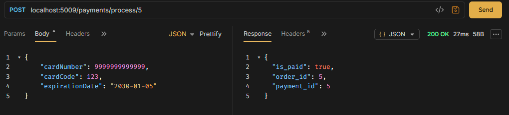
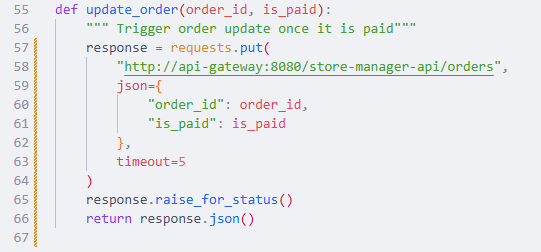
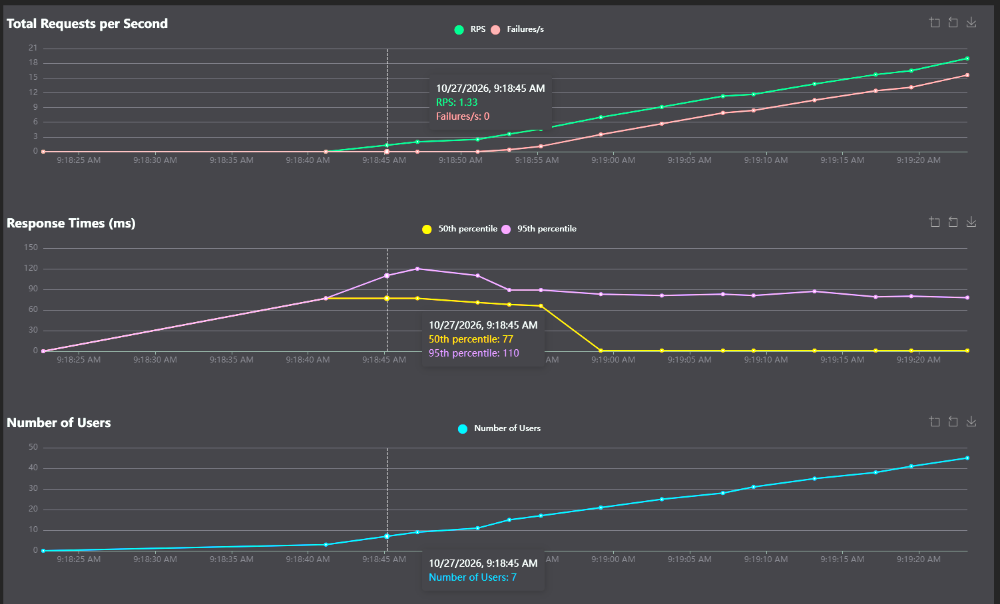
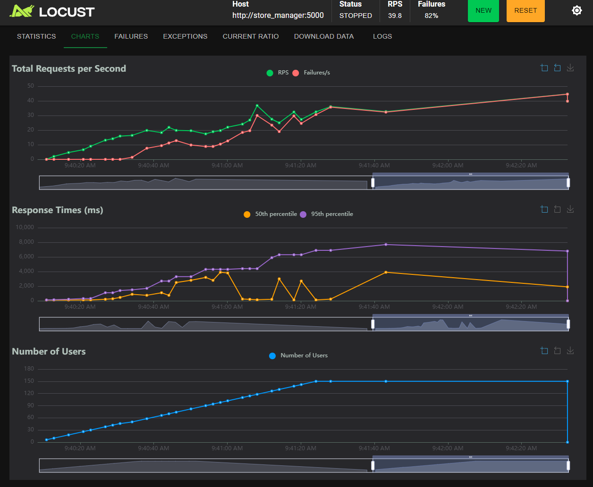

question 1:
En cas de succès, POST /payments retourne un objet JSON contenant l’identifiant de la transaction créée.
<br/>
question 2:
la requête contient dans son corps les informations de la carte de crédit:
``` json
{
    "cardNumber": 9999999999999,
    "cardCode": 123,
    "expirationDate": "2030-01-05"
}
```


<br/>
Dans une architecture SOA, le format dépend du protocole utilisé. Un service SOA utilisant SOAP recevrait généralement ces informations dans une enveloppe XML plutôt qu’en JSON. Toutefois, un service SOA peut aussi exposer une API REST et accepter le même format JSON.

<br/>
Question 3 : Quel résultat obtenons-nous de la requête à POST payments/process/:id?
<br/>
La requête retourne le statut HTTP 200 OK et le corps:
``` json
{
  "is_paid": true,
  "order_id": 5,
  "payment_id": 5
}
```
<br/>

Question 4 : Quelle méthode avez-vous dû modifier dans log430-labo05-payment et qu'avez-vous modifiée ? Justifiez avec un extrait de code.
<br/>
Nous avons modifié update_order et son appel dans process_payment, dans src/controllers/payment_controller.py du service de paiement.

<br/>

Question 5:
<br/>
à partir de 1.33 requête par seconde


<br/>
Question 6: 
<br/>

Lorsqu’on appelle /store-manager-api/test/slow/10, le délai demandé dépasse le timeout de 5 secondes configuré dans KrakenD. La passerelle cesse d’attendre la réponse et le navigateur affiche une erreur HTTP 500, comme le montre la capture. À l’inverse, un délai de 2 secondes permet de recevoir la réponse normalement.
<br/>
Dans une architecture de microservices, les timeouts limitent l’attente et évitent qu’un service lent monopolise les ressources et entraîne des défaillances en cascade. Par exemple, si le service de paiement ne répond plus, le timeout permet au service de commandes de retourner rapidement une erreur plutôt que de rester bloqué.
<br/>

<br/>
etape 7 locust resultats: 
<br/>

<br/>

Lors du test de charge local atteignant 150 utilisateurs simultanés, l’endpoint POST /orders a reçu 3 192 requêtes, dont 2 630 échecs, soit 82,4 %. Le temps de réponse moyen était de 2,26 secondes, avec un 95e percentile de 6,7 secondes et un maximum de 7,75 secondes.

Les graphiques montrent une augmentation des temps de réponse et des échecs avec la charge. Les erreurs HTTP 500 proviennent principalement de MySQL : « Too many connections », ainsi que des deadlocks lors des mises à jour concurrentes des stocks. Ces résultats montrent que, dans notre environnement, l’application ne supporte pas correctement cette charge et que la gestion des connexions et des accès concurrents à la base de données constitue un goulot d’étranglement.
<br/>
